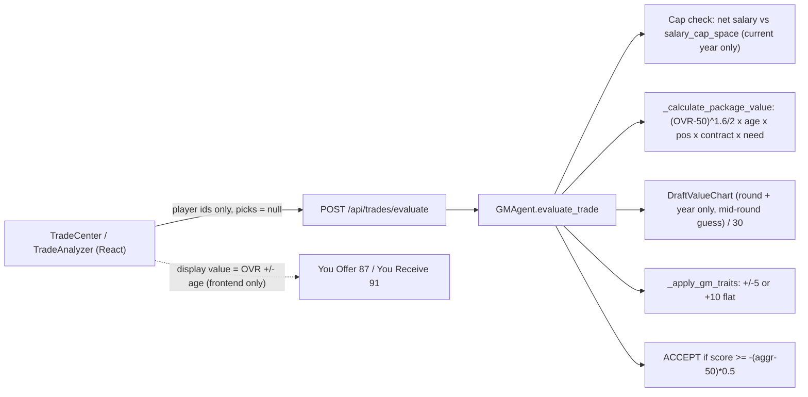
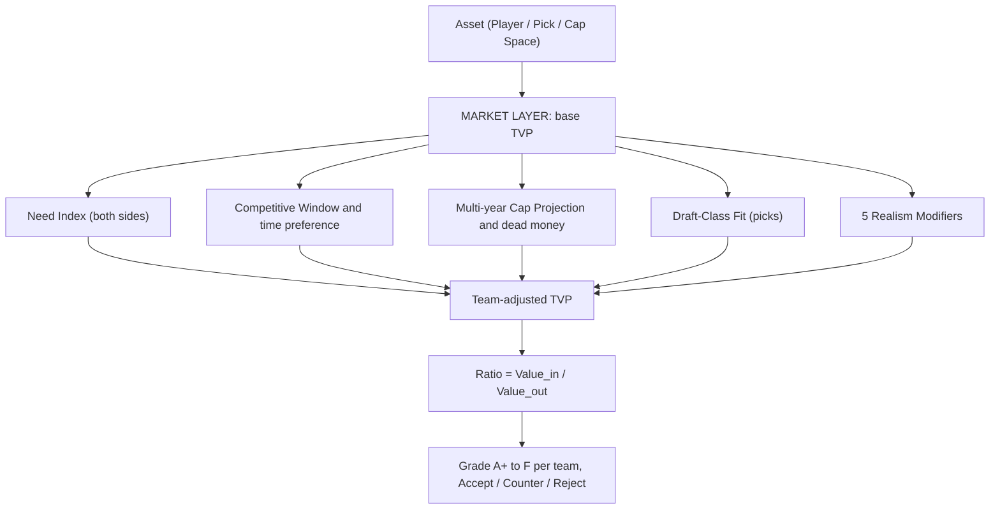

# TASK: Contextual Trade Value Engine (CTVE): Trade System Review and Redesign

> [!NOTE]
> This is a **review plus design spec**. I haven't changed any code yet. Implementation phases and the decisions I need from you are at the bottom.

---

## 0. REVIEW: How Trading Works Today

### 0.1 Current pipeline



### 0.2 Why your screenshot shows `-204.28` against a "-4" gap


The **87 / 91** numbers and the **-204** score come from two unrelated formulas:

| Layer | Formula | Scale |
|---|---|---|
| Frontend [tradeApi.ts](file:///c:/Users/cweir/OneDrive/Desktop/DevOps/THE-NFL-SIM-V2/frontend/src/services/tradeApi.ts#L48-L60) `calculateTradeValue` | `OVR + age bump`, with salary **hard-coded to $5M** and years to **2** | 0–100 |
| Backend [gm_agent.py](file:///c:/Users/cweir/OneDrive/Desktop/DevOps/THE-NFL-SIM-V2/backend/app/services/gm_agent.py#L312-L385) | `((OVR-50)^1.6)/2 × age × pos × contract × need` | 0–~400 per player |

On the backend, a 90-OVR player is worth about 183 and an 80-OVR player about 116. That makes a 4-point UI gap worth about 200 backend points. The acceptance threshold, meanwhile, is a **fixed absolute ±25** ([gm_agent.py#L125](file:///c:/Users/cweir/OneDrive/Desktop/DevOps/THE-NFL-SIM-V2/backend/app/services/gm_agent.py#L125-L127)), so small trades get a lot of slack and big trades get almost none. "GM Adjusted = Base" because a BALANCED GM gets no modifier at all, and the [`GMArchetype`](file:///c:/Users/cweir/OneDrive/Desktop/DevOps/THE-NFL-SIM-V2/backend/app/core/trade_config.py#L7-L81) config is never read.

### 0.3 Findings (ordered by severity)

| # | Severity | Finding | Location |
|---|---|---|---|
| 1 | 🔴 Critical | **Position keys don't match the `Position` enum.** Config uses `EDGE/LT/RT/OL/DL`, but the enum is `DE/OT/OG/C/DT`. As a result DE and OT fall through to the 1.00 "STANDARD" tier (the 1.25 premium is never applied), and the OL/DL need bonuses never fire. | [trade_config.py#L24-L50](file:///c:/Users/cweir/OneDrive/Desktop/DevOps/THE-NFL-SIM-V2/backend/app/core/trade_config.py#L24-L50), [gm_agent.py#L402-L407](file:///c:/Users/cweir/OneDrive/Desktop/DevOps/THE-NFL-SIM-V2/backend/app/services/gm_agent.py#L402-L407) |
| 2 | 🔴 Critical | **No common currency.** Raw differences are never normalized, picks are divided by an arbitrary `/30`, and the frontend uses a third scale. | gm_agent.py, tradeApi.ts |
| 3 | 🔴 Critical | **Picks can't really be traded.** The analyzer always sends `offered_picks: null`. Picks are `{round, year}` with no owner check. Accepting an offer moves only players, never picks. Future-year `DraftPick` rows don't exist (they're created only once draft order is final). | [TradeAnalyzer.tsx#L39-L49](file:///c:/Users/cweir/OneDrive/Desktop/DevOps/THE-NFL-SIM-V2/frontend/src/components/trades/TradeAnalyzer.tsx#L39-L49), [trades.py#L328-L346](file:///c:/Users/cweir/OneDrive/Desktop/DevOps/THE-NFL-SIM-V2/backend/app/api/endpoints/trades.py#L328-L346), [offseason_service.py#L440-L451](file:///c:/Users/cweir/OneDrive/Desktop/DevOps/THE-NFL-SIM-V2/backend/app/services/offseason_service.py#L440-L451) |
| 4 | 🟠 High | **Need is applied only to incoming players.** Giving up your only starting QB costs the same as giving up a backup. | gm_agent.py#L350-L353 |
| 5 | 🟠 High | **Need = raw headcount and average OVR** of everyone at the position. It ignores starters vs. depth, age cliffs, expiring contracts, and young pipeline players. | [gm_agent.py#L387-L414](file:///c:/Users/cweir/OneDrive/Desktop/DevOps/THE-NFL-SIM-V2/backend/app/services/gm_agent.py#L387-L414) |
| 6 | 🟠 High | **The age curve is the same for every position**: `<24 ×1.3`, then -5%/yr after 30. Meanwhile `POSITION_CAREER_DATA` exists and is unused. RBs and QBs age on completely different curves. | gm_agent.py#L324-L330, nfl_reference_data.py#L163 |
| 7 | 🟠 High | **The cap check covers the current year only** and ignores NFL trade rules: remaining signing-bonus proration **accelerates onto the trading team as dead money**, and the acquirer takes only base salary. No multi-year projection, and the trade isn't posted to the cap ledger. | gm_agent.py#L76-L94 |
| 8 | 🟡 Medium | **Future picks use a "1 round per year" lookup at the mid-round slot.** Every team's future 1st is worth the same, whether it belongs to a 2-15 team or a 15-2 team. Hard-coded `2025` base year. The top-10 picks get an extra **+20% tax** on top of a chart that already has that curve built in (double counting). | [draft_value_chart.py#L103-L157](file:///c:/Users/cweir/OneDrive/Desktop/DevOps/THE-NFL-SIM-V2/backend/app/data/draft_value_chart.py#L103-L157) |
| 9 | 🟡 Medium | **Contract value uses fixed salary bands** ($25M/$15M/$5M), not position markets. A $25M QB and a $25M RB are graded the same way. | gm_agent.py#L226-L277 |
| 10 | 🟡 Medium | `potential` and `development_trait` are never used, so youth has no upside model. | — |
| 11 | 🟡 Medium | **Three competing evaluators**: `GMAgent`, `empire/gm_ai.GMAI` (its own Jimmy Johnson chart), and the legacy `/season/{id}/gm/evaluate-trade`. | — |
| 12 | 🟢 Low | Offering team is inferred from the first offered player, so pick-only offers fail. Clicking "Analyze" writes a `GMDecision` row (side effect). The score isn't rounded (14 decimals). | trades.py#L206-L216 |

---

## 📋 PHASE 1: CONCEPTUAL EXPLORATION (The Scout)

<conceptual_mapping>

- **Historical origins:** Jimmy Johnson chart (1991), then Rich Hill chart, then the **Fitzgerald-Spielberger (OTC)** chart, which is based on second-contract value and is already partly in the repo. Verified anchors: **#1 = 3000, #32 = 1244, #64 = 892**.
- **How NFL front offices actually value players:** **surplus value** (on-field value minus cap cost, over years of control), **positional market** (top APY as % of cap), and **age curves** by position.
- **Market anchors (2025 cap $279.2M; verify each offseason):**

| Pos | Top APY | % of cap | Aging cluster (PFF) |
|---|---|---|---|
| QB | ~$60M | ~21.5% | Slowest. Peak 27–32+ |
| DE/EDGE | ~$40M | ~14.3% | DL. Peak 26–29 |
| WR | ~$35–40M | ~12.5–14.4% | Pass-catcher. Peak 25–28 |
| DT | ~$32–38M | ~11.5–13.6% | DL. Peak 26–29 |
| OT | ~$28M | ~10.0% | OL. Peak 26–31 |
| CB | ~$24–26M | ~8.6–9.3% | Coverage. Peak 24–28 |
| OG / C | ~$20–27M | ~7.5–9.5% | OL. Peak 26–31 |
| S | ~$21–25M | ~7.5–9% | Coverage. Peak 25–29 |
| LB | ~$20–28M | ~7–10% | Coverage. Peak 25–28 |
| RB | ~$20–22M | ~7.5–8% | **Fastest.** Peak 23–26, cliff ~28–29 |
| TE | ~$19M | ~6.8% | Pass-catcher. Peak 26–29 |
| K / P | ~$7M | ~2.5% | Very slow |

- **Future pick market:** an average team's future 1st trades like an **early-to-mid 2nd** (~40% discount). A contender's future 1st trades like a **late 2nd** (~50–60%). A bottom-feeder's future 1st keeps **full value or carries a premium**.
- **Cap rule on trades (CBA):** the trading team eats **all** remaining signing-bonus proration as current-year dead money (split across years only if the trade happens after June 1). The acquirer takes the remaining **base salary** and any guarantees.
- **Constraints:** deterministic (seeded RNG), under 200 ms per evaluation, strict Pydantic/TS types (no `any`), and one source of truth for value (backend).

</conceptual_mapping>

---

## ⚖️ PHASE 2: ADVERSARIAL SYNTHESIS (The Architect)

<adversarial_analysis>

### Primary thesis
Tune the existing formula: fix the position keys, add per-position age curves, and normalize the score into 0–100.

### Powerful antithesis
- It's still **team-agnostic market value plus a flat need multiplier**. It can't explain why the Chiefs and the Panthers value the same future 1st differently, or why a team with a 23-year-old stud at OT won't pay for a 30-year-old OT.
- OVR-only valuation misses **contract control**. A 90-OVR CB on a $1.5M rookie deal with 3 years left is worth far more than the same player at $26M.
- Picks valued **without the draft class** ignore that a QB-rich class makes top-5 picks worth more to QB-needy teams, and that a deep EDGE class at #40 makes trading back rational.
- An absolute threshold can never scale from a 6th-round swap to a franchise-QB blockbuster.

### The superior synthesis: a three-layer engine with one currency
1. **Market Layer (team-agnostic):** every asset (player, pick, cap space) converts to **Trade Value Points (TVP)** on the Fitzgerald-Spielberger scale (#1 pick = 3000). Players are valued as **multi-year projected surplus**.
2. **Context Layer (team-specific):** each team re-prices every asset through its **Need Index, Competitive Window, Cap Projection, Draft-Class Fit, and GM personality**, on **both sides** of the trade.
3. **Decision Layer:** use a **ratio** (`value_in / value_out`) instead of a difference, compare it to a personality-driven threshold, give each side a letter grade, and auto-generate a counter-offer.

This holds up because every number is in the same unit, every team sees the deal through its own situation, and the ratio scales from depth swaps to blockbusters.

</adversarial_analysis>

---

## 🛠️ PHASE 3: ACTIONABLE BLUEPRINT (The Engineer)

<implementation_blueprint>

### 1. Technology and architecture context
- **Backend:** FastAPI + SQLAlchemy 2.0 (existing), pure-Python valuation module, Pydantic v2 schemas.
- **Frontend:** React/Vite/TS, with values fetched from the backend (delete `calculateTradeValue`).
- **New module:** `backend/app/services/trade_engine/` containing `market.py`, `picks.py`, `context.py`, `cap.py`, `class_fit.py`, `modifiers.py`, `decision.py`. It replaces the valuation inside `GMAgent` and retires `empire/gm_ai.evaluate_trade`.

### 2. The grading model



#### 2.1 Market Layer: player value

**Projected OVR per contract year** (per-position aging, potential, dev trait):

$$OVR_y = OVR_0 + \text{Growth}(age, pos, potential, dev)\cdot g_y - \text{Decline}(age_y - peakEnd_{pos})$$

**Market value in dollars**, from the position market curve:

$$MV_y = Cap_y \times TopAPY\%_{pos} \times Tier(OVR_y)$$

where `Tier` maps 99 to 1.0, 90 to ~0.72, 85 to ~0.52, 80 to ~0.33, 75 to ~0.17, and below 68 to the veteran minimum. `Cap_y` grows at the existing `SALARY_CAP_CAGR` (6.97%).

**Player TVP** (projected surplus, weighted by time preference, with a scarcity term):

$$TVP_{player} = \kappa \sum_{y=0}^{Y_{ctrl}-1} \delta_{team}^{\,y}\,\big(MV_y - \lambda \cdot CapHit_y\big) \times R_{risk}$$

- $Y_{ctrl}$ = years left on the contract, plus the **5th-year option** for 1st-rounders (rookie years 1–3), plus a **franchise-tag year** weighted by tag probability.
- $\lambda \approx 0.6$ is the cap-cost weight. Elite talent can't simply be bought in free agency, so stars on market deals still cost picks; that is the Hill and Adams pattern. CapWizard GMs use a higher λ.
- $\kappa$ converts dollars to TVP and is **fit to the pre-registered benchmarks** in §4.
- Fixes findings 6, 9, and 10. RBs lose value fast after 26 and QBs hold it into their 30s.

#### 2.2 Market Layer: draft pick value

$$TVP_{pick} = \mathbb{E}_{slot \sim P(\text{orig team finish})}\big[FS(slot)\big] \times D^{\,years} \times ClassFit_{T}(slot)$$

- **Slot distribution** comes from the *original* team's projected finish (Elo plus roster strength). Spread is σ ≈ 4 slots once standings settle, 9 for next year, and 11 for two years out. Because the chart is convex, a projected bottom-feeder's future 1st keeps near-full value and a contender's drops to 2nd-round value, which matches the real market.
- **Time discount** D ≈ 0.75 per year (tunable; scaled by archetype `future_discount`). An average future 1st lands at ~1,200 TVP, about an early 2nd.
- **Drop the extra +20% top-10 tax.** The FS curve already includes it. QB-class scarcity is handled by ClassFit instead.
- **Conditional picks / pick swaps:** value = Σ probability × value for each outcome.

#### 2.3 Context Layer: Team Need Index (TNI), 0 to 1 per position

| Input | Definition |
|---|---|
| **Starter slots** | QB1 · RB1 · WR3 · TE1 · OT2 (OT1 = blindside premium) · OG2 · C1 · DE2 · DT2 · LB2 · CB3 · S2 · K1 · P1 |
| **StarterGap (now)** | `clamp((League P75 starter OVR - team starter OVR) / 15, 0, 1)` |
| **DepthGap** | Backup OVR vs. a replacement-level threshold per position |
| **Age-cliff horizon** | Years until the starter passes `peakEnd + cliff` for the position |
| **Contract horizon** | Starter's contract ends within 1–2 years, there's no extension, and cap can't absorb it |
| **Youth pipeline offset** | Players aged 24 or younger with STAR+ dev trait or projected OVR ≥ starter bar within 2 years reduce future need |

$$TNI_{pos} = (1-h)\cdot NeedNow + h \cdot NeedFuture, \qquad h = \{Contender: 0.25,\ Bubble: 0.4,\ Retool: 0.55,\ Rebuild: 0.7\}$$

**Applied to both sides:**
- Incoming player: `TVP × (0.6 + 0.8·TNI_pos)`, capped at ×0.7 if he wouldn't start over a younger incumbent.
- Outgoing player: `TVP × (0.6 + 0.8·TNI_pos_after_removal)`. Losing your only QB now hurts.

#### 2.4 Context Layer: Competitive Window

Derived from Elo, the positionally weighted starter OVR, QB tier and age, average starter age, and cap space over the next 2 years. Output is `CONTENDER | BUBBLE | RETOOL | REBUILD`, which sets the time-preference δ:

| Window | δ (per future year) | Behavior |
|---|---|---|
| CONTENDER | 0.70 | Pays picks for vets, discounts future 1sts it owns |
| BUBBLE | 0.80 | Need-driven |
| RETOOL | 0.88 | Sells aging vets, keeps young core |
| REBUILD | 0.95 | Buys picks and youth, takes salary dumps for compensation |

#### 2.5 Context Layer: Cap and contract projection (4-year horizon)

For each team and year `y ∈ {0..3}`, after the trade:

$$Space_{T,y} = Cap_y - Commitments_{T,y} - DeadAccel_{T,y} - ReservedExtensions_{T,y} - RookiePool_{T,y}$$

- **Hard gate:** `Space_{T,0} ≥ 0` for both teams. In-season, use prorated remaining base salary.
- **DeadAccel:** the seller absorbs remaining `signing_bonus_proration` (current year, or split after June 1). The buyer absorbs `annual_base_salary` plus guarantees. The fields already exist on [`PlayerContract`](file:///c:/Users/cweir/OneDrive/Desktop/DevOps/THE-NFL-SIM-V2/backend/app/models/player_contract.py).
- **ReservedExtensions:** projected second-contract cost for the team's own young stars whose rookie deals expire (QB rookie deal ending = big reservation).
- **Cap Stress penalty:** `−κλ · Σ_y w_y · max(0, Buffer_y − Space_y)`, so trades that push a team into future cap hell get punished.
- **Cap space as an asset:** REBUILD teams with space will **take on bad contracts for pick compensation** (the Osweiler model).
- Reuse `CapologyEngine.calculate_multi_year_projection`, `SalaryCapEngine.project_cap`, and post the executed trade to `CapLedgerService`.

#### 2.6 Context Layer: Draft-Class Fit (current-year picks only)

$$ClassFit_T(slot) = clamp\left(\frac{\mathbb{E}[\max_{p \in Avail(slot)} Grade_p \cdot (0.6+0.8\,TNI_{T,pos(p)})]}{\mathbb{E}[\max_{p \in Avail(slot)} Grade_p]_{league}},\ 0.85,\ 1.25\right)$$

- `Avail(slot)` comes from **200 seeded Monte-Carlo mock drafts**: a consensus board plus scouting noise, with each team ahead of the slot picking by its own TNI. Results are cached per draft state and re-run after every pick on draft day.
- **Positional Run Risk:** the probability that the top-k prospects at T's top-need position are gone before T's next pick. This is what drives trade-up urgency.
- **Class Strength Index per position:** a QB-rich class raises the value of top-10 picks for QB-needy teams. A deep class at a team's need around #40 makes trading back the right call.
- Future classes use 1.0, with GM `scouting` adding small noise to perceived value.

#### 2.7 Decision Layer

$$Ratio_T = \frac{\sum TVP^{adj}_{in}}{\sum TVP^{adj}_{out} + DeadAccel_T + \Delta CapStress_T}$$

**Accept if** $Ratio_T \ge \tau_T$, where

`τ = 1.00 + archetype (HOARDER +0.10 · SNIPER −0.05 if top-3 need · AGGRESSIVE −0.05) + negotiation margin (0 to +0.06) + rivalry tax − panic factors`

| Ratio | Grade | | Ratio | Grade |
|---|---|---|---|---|
| ≥ 1.25 | A+ | | 0.92–0.97 | B- |
| 1.15–1.25 | A | | 0.87–0.92 | C+ |
| 1.07–1.15 | A- | | 0.82–0.87 | C |
| 1.02–1.07 | B+ | | 0.75–0.82 | D |
| 0.97–1.02 | B | | < 0.75 | F |

- **Counter-offer:** if `0.80 ≤ Ratio < τ`, the AI runs a small knapsack over the user's tradable assets to find the **cheapest package that closes the gap**, preferring assets at its top-3 TNI positions.
- **Both teams get graded.** The UI shows *"Your grade: B+ · Their grade: B-"* with factor bars (Market, Need Fit, Cap, Window, Class Fit, Risk, Personality).

### 3. The 5 missing parameters for hyper-realism

| # | Parameter | What it models | Data already in repo | Effect |
|---|---|---|---|---|
| **1** | **Injury and Durability Risk** | Injury history, games missed, current status, and the "failed physical" voided-trade scenario. The team's medical rating sets how confident it is in the evaluation. | `player_injury`, `medical`, `Team.medical_rating`, `InjuryStatus` | `R_risk` 0.6–1.0. Seeded chance of a voided trade for players currently injured |
| **2** | **Scheme and Coaching Fit** | DE in a 3-4 → OLB fit; zone vs. man CB; WR route profile vs. offense. Bonus for coach connection (player has played for the staff before). | `coach`, `gameplan`, `player_attributes` | Fit multiplier 0.80–1.10 on *team-adjusted* value |
| **3** | **Locker Room, Morale and Trade Requests** | A trade request kills seller leverage (−10–20% price; the Diggs/Ramsey pattern). Veteran-leadership premium for young teams; malcontent penalty for contenders. | `psychological_dna`, `tension_score`, `trust_in_coach`, `morale` | Seller τ drops; buyer value ±10% |
| **4** | **Market Leverage, Calendar and Comp-Pick Floor** | Number of rival bidders (teams with need, cap, and the right window), deadline urgency, draft-day vs. offseason timing. A seller won't accept less than the **comp pick** it would get by letting the player walk. | `CapologyEngine.evaluate_comp_pick_formula`, `PANIC_MULTIPLIERS.DEADLINE_URGENCY` (unused) | Bidding premium up to +25%; a hard floor at the comp-pick TVP |
| **5** | **GM Relationship Graph and Division Rivalry Tax** | Intra-division trades cost +10–15%. GMs remember lopsided past trades (trust deficit). Hot-seat GMs overpay for vets. | `GMDecision` log, `GM.league_reputation`, `GM.owner_trust`, `PANIC_MULTIPLIERS.JOB_SECURITY_LOW` (unused) | τ adjustments; "they fleeced me last time" reasoning text |

**Honorable mentions** (phase 6+): owner mandates (`owner_ai.issue_mandate`), trade-and-extend (player must agree to a new deal), 53/90 roster-limit enforcement, conditional picks tied to playing time, post-June-1 calendar effects.

### 4. Data schema (pre-generation)

```python
# backend/app/core/trade_config.py  (keys MUST match Position enum)
class PositionValueProfile(BaseModel):
    position: Position                 # QB RB WR TE OT OG C DE DT LB CB S K P
    top_apy_pct_cap: float             # e.g. QB 0.215, DE 0.143, RB 0.078
    starters_required: int             # WR 3, CB 3, OT 2 ...
    peak_start: int; peak_end: int     # RB 23-26, QB 27-32
    decline_per_year: float            # RB 0.15, QB 0.03
    cliff_age: int                     # RB 29, QB 37

# backend/app/schemas/trade.py  (new response)
class FactorBreakdown(BaseModel):
    market: float; need_fit: float; cap_impact: float
    window_fit: float; class_fit: float; risk: float; personality: float

class TeamTradeGrade(BaseModel):
    team_id: int
    value_in: float; value_out: float; ratio: float
    grade: Literal["A+","A","A-","B+","B","B-","C+","C","D","F"]
    factors: FactorBreakdown
    cap_projection: list[CapYearProjection]   # y0..y3 before/after

class TradeEvaluationResponseV2(BaseModel):
    decision: Literal["ACCEPT","COUNTER","REJECT"]
    user_side: TeamTradeGrade; ai_side: TeamTradeGrade
    counter_offer: TradeOfferRequest | None
    reasoning: list[str]
```

**DraftPick changes (Alembic):** pre-create picks for **current + 2 future seasons**. `pick_number` becomes nullable until the order is set. Add `year`, `is_compensatory`, and `conditions JSON`. Draft-order generation must **update** existing rows (keeping traded ownership) instead of creating new ones.

### 5. Step-by-step execution

- [ ] **Phase 0: Bug fixes (no redesign).** Position-key alignment, OL/DL need keys, round the score, send picks from the analyzer, remove hard-coded salary/years in the frontend, move picks on accept, derive the offering team correctly, remove the hard-coded 2025, make Analyze side-effect free, retire the legacy endpoint.
- [ ] **Phase 1: Market Layer.** `PositionValueProfile`, aging curves, `Tier`, surplus TVP, κ calibration.
- [ ] **Phase 2: Pick ledger and pick value.** Future picks in the DB, projected-slot EV, time discount, conditional picks.
- [ ] **Phase 3: Team context.** TNI, Competitive Window, youth pipeline, two-sided need.
- [ ] **Phase 4: Cap layer.** 4-year projection, dead-money acceleration, cap stress, ledger posting on execution.
- [ ] **Phase 5: Draft-Class Fit.** Monte-Carlo availability, run risk, class strength index.
- [ ] **Phase 6: The 5 realism modifiers.**
- [ ] **Phase 7: Decision and UI.** Ratio, grades, counter-offer knapsack, dual grade cards, factor bars, cap before/after heatmap (reusing `MultiYearCapHeatmap.tsx`).

### 6. Edge cases and error handling
- **Missing contract row:** fall back to the rookie scale for the player's experience. Never use the current $1M default silently; log it as low-confidence.
- **No GM on team:** BALANCED profile (as today).
- **Pick > 3 years out / not owned:** 400 error with a clear message (currently it fails silently inside a `try`).
- **Pick-only trades, 3-team trades:** offering team comes from the request body, not from inference.
- **Empty draft class (future years):** ClassFit = 1.0.

</implementation_blueprint>

---

## 🛡️ PHASE 4: THE AUDITOR (Verification)

<final_audit>

**Pre-registered calibration benchmarks.** These bands are fixed before tuning κ. They are a target, not something to adjust after looking at outputs.

| Archetype (synthetic player built to match) | Real precedent | Target TVP band |
|---|---|---|
| 29-yr 95+ WR, new market deal | Davante Adams 2022 (#22 + #53) | 2,200 – 2,800 |
| 24-yr 92 CB, 2 cheap years left | Jalen Ramsey 2019 (two 1sts + 4th) | 2,800 – 3,600 |
| 26-yr 95 RB, market deal | Christian McCaffrey 2022 (2nd+3rd+4th+5th) | 1,600 – 2,400 |
| 30-yr 85 WR, market deal | Stefon Diggs 2024 (2nd) | 800 – 1,200 |
| 33-yr 88 QB, large contract | Russell Wilson 2022 (2×1st + 2×2nd + players) | 3,500 – 4,500 |
| Average team's future 1st | Market convention | 1,100 – 1,350 (~early 2nd) |

**Property tests (must hold):**
- Monotonic: higher OVR raises TVP; more cheap control years raise TVP.
- RB value at age 29 < 60% of value at 25. QB value at 33 > 75% of value at 28.
- A contender's future 1st < an average team's future 1st < a bottom-feeder's future 1st.
- The same trade evaluated from both sides: `Ratio_A × Ratio_B ≈ 1` when context is neutral.
- Seller dead money equals the remaining `signing_bonus_proration`.
- Under 200 ms per evaluation (ClassFit served from cache).

**Checklist**
- [ ] **Type check:** no `any` (TS), mypy clean on `trade_engine/`.
- [ ] **Security:** input validation on pick ownership and team membership. No state writes on `/evaluate`.
- [ ] **Performance:** ClassFit Monte-Carlo cached per draft state.
- [ ] **Self-critique:** κ and λ are fitted constants. If the benchmarks can't all fit at once, the surplus formula needs a separate star-scarcity term rather than more fudge factors.

</final_audit>

---

<baton_handoff>
**Next immediate step:** confirm scope and the open decisions below, then I'll start with Phase 0 (bug fixes, with tests written first) and Phase 1.
</baton_handoff>
